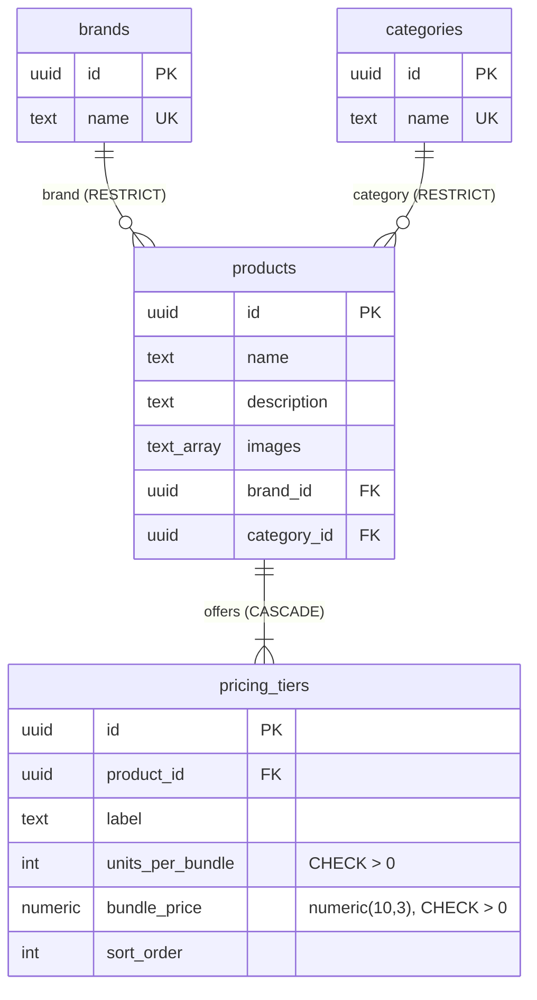

# NCG Pharmacy — Medical e-commerce with multi-tier bundle pricing

Technical assessment for **National Care Group** (Vibe Coder task).

- **Live app:** https://ncg-medical-store.lovable.app
- **Admin panel:** https://ncg-medical-store.lovable.app/admin (open to anyone: authentication is out of scope)
- **Repository:** https://github.com/muhamaadessam/ncg-medical-store

## Features

| Page | What it does |
| --- | --- |
| **Home** `/` | Product grid with images, brand and category badges, and **every pricing option** per product. Filter by brand and/or category (with counts). Filters live in the URL, so they survive a refresh and can be shared. Pick an offer and add it to the cart straight from the card. |
| **Product details** `/products/:id` | Gallery, brand, category, description, all offers as selectable cards (per-pack price + "Best value"), a 1–99 bundle stepper and a live total (`2 × 4 Packs · 8 packs · 39.000 KWD`). |
| **Cart** `/cart` | One line per offer with the offer name, bundle price, bundle stepper, internal pack count and line total. Shows total bundles, total packs and subtotal. Lines can be updated or removed, and totals are recalculated instantly. |
| **Admin** `/admin` | Create, edit and delete products (name, description, uploaded or linked images, brand, category) with **any number of pricing tiers** (label, units per bundle, bundle price, order). Manage brands and categories too. Changes are saved to Postgres and appear on the storefront immediately. |

Every page has loading, error and empty states and is responsive (360px → desktop).

## Pricing and cart logic

The brief's rules, and how the code enforces them:

1. **A tier is an independent bundle.** `pricing_tiers.bundle_price` is the **total** price of the bundle, never a per-pack price. A product can have 1, 2, 3 or more tiers, and nothing hardcodes a count.
2. **Cart lines are keyed by `tierId`**, not by product. Two offers of the same product are two separate lines, and adding the same offer again increases its bundle count.
3. **Line total = bundle price × bundles.** The internal pack quantity is derived as `units_per_bundle × bundles`.

   > 2 × "4 Packs" at 19.500 KWD → **8 packs**, **39.000 KWD** (never 8 × 19.500)
4. **Money is integer fils.** 1 KWD = 1000 fils. Prices are converted once with `toFils`, all math is integer, and `formatKWD` prints exactly 3 decimals. No float arithmetic and no `toFixed`.
5. **The cart stores no prices.** It holds only `{ tierId, bundles }` in `localStorage` and joins with the live catalog on every render. An admin price change is reflected in the cart, and an offer deleted in the admin is removed from the cart with a notice.
6. **Valid quantities only.** Bundles are whole numbers from 1 to 99. Typing 0, negatives, decimals, text or > 99 is corrected with an inline hint, and the cart store rejects invalid values.

Relevant code: `src/lib/money.ts`, `src/features/cart/cartMath.ts`, `src/features/catalog/lib/pricing.ts`, `src/features/catalog/lib/bundles.ts`.

## Tech stack

- **Frontend:** React 19 + TypeScript, Tailwind CSS v4, shadcn/ui, TanStack Router / Start (SSR), TanStack Query, react-hook-form + zod, sonner
- **Backend:** Lovable Cloud (Supabase): PostgreSQL + Row Level Security, with TanStack Start **server functions** for admin writes
- **Tests / tooling:** Vitest + Testing Library, ESLint + Prettier, GitHub Actions CI, Bun

## AI tools used

- **Lovable:** initial build (database schema, seed data, money helpers, home page, product details page)
- **Claude (Anthropic):** planning, writing the Lovable prompts, and code review
- **Claude Code:** cart, admin panel, server functions, tests, CI and documentation (pushed to this repo, which syncs both ways with Lovable)

## Database



- `UNIQUE (product_id, units_per_bundle)`: a product can't have two offers of the same size.
- A brand or category that is still used by a product can't be deleted (RESTRICT). Deleting a product deletes its offers (CASCADE).
- Seed data: 2 brands, 2 categories and 4 products. **Digital Thermometer** has 1 offer, **Sterile Gauze Pads** has 2, **Vitamin D3** has 3 (5.500 / 19.500 / 55.000 KWD), and **Omega-3** has 2.
- Migrations: `drizzle/migrations/`.

### Access model

Authentication is out of scope, so the admin needs no login. Even so, the browser does **not** get write access to the database:

- RLS allows **public read** of the catalog only.
- Every admin write is a TanStack Start **server function** (`src/features/admin/admin.functions.ts`). It validates the input with the same zod schemas the forms use (`src/features/admin/schemas.ts`) and then writes with the server-side service-role client. The key never reaches the browser.
- A product and its pricing tiers are saved **in one transaction** by the Postgres function `save_product_with_tiers` (executable by the service role only). Removed tiers are deleted, kept tiers are updated in place (their ids stay the same, so carts pick up new prices), and new tiers are inserted. Bundle sizes can even be swapped between tiers without breaking the `UNIQUE (product_id, units_per_bundle)` rule.
- Image uploads (JPG/PNG/WebP, ≤ 3 MB) go through a server function into the private `product-images` storage bucket.

## Project structure

```
src/
  routes/                 thin TanStack file routes: head(), loader (prime cache), pending/error/not-found UI
  pages/                  page components (Home, Product, Cart, Admin)
  features/
    catalog/              queries + hooks, filters, pricing helpers, product cards, product details
    cart/                 cartMath.ts (pure logic), cartStore.ts (localStorage store), cart UI
    admin/                zod schemas, server functions, products / brands / categories managers, product form
  lib/                    money.ts (fils + KWD formatting), utils
  components/             layout (header, page container) and shadcn/ui primitives
  integrations/supabase/  generated Supabase clients and types
  types/                  row types re-exported from the generated DB types
drizzle/migrations/       SQL schema, RLS policies and seed data
```

## Local setup

Requires **Bun** (or Node 20+ with npm).

```bash
git clone https://github.com/muhamaadessam/ncg-medical-store.git
cd ncg-medical-store
bun install
bun run dev            # then open the local URL Vite prints
```

Environment variables (`.env`; the publishable values are already committed for the demo):

| Variable | Used by |
| --- | --- |
| `VITE_SUPABASE_URL`, `VITE_SUPABASE_PUBLISHABLE_KEY` | browser client (read-only catalog) |
| `SUPABASE_URL`, `SUPABASE_SERVICE_ROLE_KEY` | server functions (admin writes); provided by Lovable Cloud, **never commit it** |

## Testing

```bash
bun run test     # Vitest
bun run lint
bun run build
```

CI (`.github/workflows/ci.yml`) runs lint, type check, tests and build on every push.

**Automated tests (65)** cover:

- money: fils conversion, float noise, 3-decimal formatting
- pricing: per-pack price, best value by integer cross-multiplication, bundle totals
- bundle input correction (0, negatives, decimals, text, > 99)
- cart: the brief's 39.000 KWD / 8 packs example, separate lines per offer, merging the same offer, Product C with all three offers = 99.500 KWD / 21 packs, invalid quantities, deleted offers, and corrupt `localStorage` data
- admin validation: at least one tier, unique bundle sizes, positive prices with ≤ 3 decimals, required fields, image URLs
- storefront filters and routing

**Manual checklist (run on the live link):**

- [ ] Home shows Thermometer (1 offer), Gauze Pads (2) and Vitamin D3 (3), and brand/category filters work, also after a refresh
- [ ] Vitamin D3 → 4 Packs × 2 shows `8 packs` and `39.000 KWD` on the product page and in the cart
- [ ] The same product with two offers gives two cart lines, and the same offer twice gives one line with 2 bundles
- [ ] Changing a quantity or removing a line updates the totals; an empty cart shows the empty state
- [ ] Admin: create a product with 4 tiers, and it appears on the storefront; edit a price, and the cart reflects it
- [ ] Admin: price `0`, duplicate bundle sizes or no tiers are rejected inline; deleting a brand in use is blocked
- [ ] Mobile (360px): no horizontal scroll, sticky add-to-cart bar on the product page

## Known limitations

- **No authentication** (out of scope): anyone with the link can use `/admin`. Writes are still server-side and validated.
- **Uploaded images use long-lived signed URLs.** The `product-images` bucket is private (the workspace doesn't allow public buckets), so an upload stores a 10-year signed link. Image links from other sites can be pasted too.
- **The cart is per browser** (`localStorage`). Checkout, payment, orders, delivery and inventory are out of scope.
